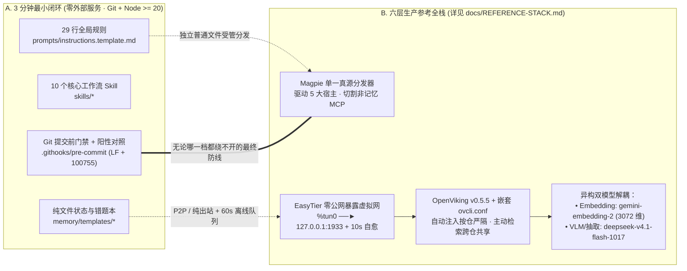

# gate-first

**让规则长成门禁，而不是把提示词越写越厚。**  
面向高强度 AI 辅助研发的跨宿主协作规范、10 个实战工作流 Skill、自增长确定性门禁与分层长期记忆架构。

[](./LICENSE)
[](./package.json)
[](./package.json)
[](https://abca12a.github.io/gate-first/)

[**在线交互式全景蓝图 (`abca12a.github.io/gate-first`)**](https://abca12a.github.io/gate-first/) · [**本地展示页 (`showcase/index.html`)**](./showcase/index.html) · [**生产配套全栈白皮书 (`docs/REFERENCE-STACK.md`)**](./docs/REFERENCE-STACK.md) · [**English README (`README.en.md`)**](./README.en.md)

---

## 为什么做 `gate-first`？

重度使用编码 Agent 几个月后，大多数工程团队都会撞上同一种退化闭环：

1. **提示词泥石流**：每踩一个坑就往 `CLAUDE.md` / `AGENTS.md` 末尾塞一段「严禁……」「切记……」。文件涨到 500 行后，每轮对话白白烧掉上万常驻 Token，模型在长文中段注意力塌陷，连最基础的红线也开始漏看。
2. **「只提醒不报错」形同虚设**：脚本打印黄色警告但退出码是 `0`；真实复盘证明，一条写了三处文档、每次开工都打警告的 120 行上限，在 8 天内照样膨胀到 **569 行 / 104 KB**。
3. **多会话与子代理互踩**：几个 Agent 同时改一个工作区，或者子代理把几十轮排错废话直接写回全局记忆，一周之内工作树与长期记忆双双失控。
4. **多宿主资产分裂**：主力切换 Claude Code、Codex、DSH、OpenCode、Antigravity 时，提示词和技能靠手工拷贝，改一处漏四处，甚至踩中多宿主软链共指同一共享中转文件导致覆写清空成 `0` 字节。

`gate-first` 给出的工程解法只有四句话：

- **常驻全局规则死守 ~30 行**：只留不可妥协的授权、角色与验收红线，分支知识全部退到**上下文指针（Skill）**之后按需披露（[`prompts/README.md`](./prompts/README.md)）。
- **唯一主导 + 隔离执行者**：一个主导会话负责对齐、拆单、审查与合并；多写者强制走独立 `git worktree` 与独立分支（开工前 `--phase pre` + 提交后 `--phase post` 两阶段校验），子代理只回报证据、严禁写长期记忆（[`skills/lead-orchestration/`](./skills/lead-orchestration/SKILL.md)）。
- **事故向机器门禁单向收敛**：凡能二元判定的约束一律下沉为 `.githooks/pre-commit` 里 **`exit 1`** 的零依赖检查器，并强制配备**阳性对照**证明它真的会变红（[`gates/PROTOCOL.md`](./gates/PROTOCOL.md)）。
- **后端无关的四层记忆契约**：从零服务的纯 Markdown 模板，平滑演进到零公网暴露虚拟网 + 异构双模型向量与语义编译引擎（[`memory/CONTRACT.md`](./memory/CONTRACT.md)）。

> 💡 **交互式全景蓝图**：直接点击访问在线版 [**`https://abca12a.github.io/gate-first/`**](https://abca12a.github.io/gate-first/)（或本地打开 [**`showcase/index.html`**](./showcase/index.html)），即可交互式浏览六层架构流转、EasyTier 加密组网、双模型记忆流水线与门禁阳性对照实验室。

---

## 它是什么 / 不是什么

| 它是 | 它不是 |
|---|---|
| 一套**零外部 npm 依赖**、克隆即可在任意 Git 仓库落地的工程治理骨架 | 不是又一个绑死某家 SDK 的重型多智能体编排框架（LangGraph / CrewAI 类） |
| 10 个来自高密度生产实战、经过宿主中立化门禁验证的工作流 Skill | 不是未经实战检验的百条“AI 提示词大全”合集 |
| 一套跨 Claude Code、Codex、DSH、OpenCode、Antigravity 通用的提交点门禁协议 | 不强迫你第一天就部署向量数据库——最小闭环只需 `Git` + `Node.js >= 20` |

---

## 全景架构：3 分钟最小闭环 vs 六层生产参考全栈

你可以只用本仓内置资产在 **3 分钟内启动零外部依赖闭环**，也可以按 [`docs/REFERENCE-STACK.md`](./docs/REFERENCE-STACK.md) 扩展到多机多宿主生产全栈：



---

## 3 分钟快速上手

### 1. 先跑一遍本仓自身的狗粮总门禁（验证环境与全部阳性对照）

```bash
git clone https://github.com/abca12a/gate-first.git
cd gate-first
npm test
```

`npm test`（即 `node scripts/check-all.mjs`）会在几秒内完成：10 个 Skill 格式与内置自测、宿主中立性扫描、依赖闭包与 `worktree` 两阶段自测、本仓 `docs/STATE.md` 120 行上限检查、全仓 GFM 链接与锚点校验、3 个门禁样本的子进程阳性对照、Git 钩子字节级 `\r` 零残留与 `100755` 索引可执行位校验，以及隐私/凭据脱敏扫描。

### 2. 一条命令给你的现有或新建 Git 仓库装上协作与门禁骨架

```bash
node scaffold/init-project.mjs /path/to/your-repo --gate-command "npm test"
```

脚手架遵循**「先认领、再创建」**原则：自动识别目标仓库是否已有 `CLAUDE.md`、`package.json` 门禁脚本或既有 `core.hooksPath`，绝不覆盖已有文件、绝不残留未启用的冗余钩子，并指导以 `git add --chmod=+x` 保证跨平台可执行位（详见 [`scaffold/README.md`](./scaffold/README.md)）。

### 3. 挂载全局规则与 10 个核心 Skill

- 将 [`prompts/instructions.template.md`](./prompts/instructions.template.md)（基础版或完整版）写入宿主全局指令文件；
- 将 `skills/` 下的技能软链至宿主技能目录（如 `~/.agents/skills/` 或 `~/.claude/skills/`），之后运行 `npm run check:skills` 验证零断链。

---

## 内置 10 个核心工作流 Skill 索引（4 核心底座 + 6 生命周期治理）

所有内置 Skill 均通过 `check-host-neutral.mjs` 宿主中立性门禁校验，不硬绑单一宿主专有接口：

### 核心底座（4 个）

| Skill | 触发时机与核心职责 | 附带脚本 / 模板 |
|---|---|---|
| **[`lead-orchestration`](./skills/lead-orchestration/SKILL.md)** | 协作总纲：唯一主导拆单审查、「三派三不派」判据、多会话 `git worktree` 两阶段隔离、编码前工程规范 | `init-project.mjs`、`check-worker-workspace.mjs`（`pre`/`post`）、工单与证据回报模板 |
| **[`pit-to-gate`](./skills/pit-to-gate/SKILL.md)** | 事故转化器：修完 bug 或被纠正后，按三判据分流到机器门禁、Skill 或文档，严防自证循环假绿 | 见 [`gates/PROTOCOL.md`](./gates/PROTOCOL.md) |
| **[`defect-review`](./skills/defect-review/SKILL.md)** | 独立只读缺陷审查：基于真实合并基准 `merge-base` 定位可证伪回归缺陷（P0–P3），剥离风格挑刺 | — |
| **[`project-orientation`](./skills/project-orientation/SKILL.md)** | 陌生项目接手与中断恢复：厘清资料分工、建立可执行功能地图、分层记账设计/代码/测试/生产状态 | — |

### 专项生命周期治理（6 个）

| Skill | 触发时机与核心职责 | 披露参考 / 工具 |
|---|---|---|
| **[`audit-fix-loop`](./skills/audit-fix-loop/SKILL.md)** | 外部审计单闭环：先证伪报告前提，再按「最小回归 → 修复 → 退回旧版做阳性对照」逐项清零 | [`CASE-NOTES.md`](./skills/audit-fix-loop/CASE-NOTES.md)（8 类环境伪装坑） |
| **[`docs-drift-audit`](./skills/docs-drift-audit/SKILL.md)** | 文档漂移治理：识别前提失效、悬空引用、过期状态与计数腐烂，安全冷热分离并规避归档断链与 `$` 展开炸弹 | — |
| **[`release-and-verify`](./skills/release-and-verify/SKILL.md)** | 推送与发布核验：确认构建产物新鲜度、分叉仓显式 `--repo` 查真 CI 结论、字节级分片 `sha256` 对账 | [`FIELD-NOTES.md`](./skills/release-and-verify/FIELD-NOTES.md) |
| **[`git-branch-worktree-cleanup`](./skills/git-branch-worktree-cleanup/SKILL.md)** | 分支与工作树收敛：量化未合并提交，守住 4 个不可逆点（远端独有分支、被忽略日志、进程占用、`node_modules` 软链穿透） | — |
| **[`retire-dead-subsystem`](./skills/retire-dead-subsystem/SKILL.md)** | 废弃子系统干净摘除：按 `import` 边建反向引用表，先摘硬依赖再清休眠件，保留跨工具通用判据 | — |
| **[`skill-maintenance`](./skills/skill-maintenance/SKILL.md)** | 技能库自身治理：处理触发重叠、单一真源拓扑校验、悬空软链穿透检测与宿主中立性守护 | 4 个零依赖 `.mjs` 检查器 + [`magpie-adapter.md`](./skills/skill-maintenance/references/magpie-adapter.md) |

---

## 3 个真实生产事故 → 确定性门禁样本

在 [`gates/examples/`](./gates/PROTOCOL.md) 中，每条门禁都保留了**真实事故复盘（`INCIDENT.md`）+ 零依赖检查器 + 子进程阳性对照测试（`test-positive-control.mjs`）**：

| 样本目录 | 真实生产事故现场 | 门禁如何根治 |
|---|---|---|
| **[`01-state-log-cap`](./gates/examples/01-state-log-cap/INCIDENT.md)** | 状态上限 `120` 行同时写了三处文档，开工脚本超限时打警告但 `exit 0`；**8 天后长到 569 行 / 104 KB**，每次开工灌爆上下文 | 抽出单一常量源 `state-section.mjs`，独立 `check-state-log.mjs` 超限或空节直接 **`exit 1`** |
| **[`02-doc-links`](./gates/examples/02-doc-links/INCIDENT.md)** | 归档 `STATE.md` 时正文一字未改，仅因移入 `docs/archive/` 深了一层目录导致 **4 条相对链接静默断链**；初版上 CI 又因缺外部对照仓误报 **53 条假死链** | 仓库内相对路径与 GFM `#anchor` 100% 强校验；跨仓绝对路径仅在外部 `.git` 挂载时判错，未挂载时显式报「未校验 N 条」 |
| **[`03-secret-shapes`](./gates/examples/03-secret-shapes/INCIDENT.md)** | 初版密钥扫描默认 `git ls-files` 只看暂存区，**漏掉了尚未 `git add` 的含密钥新文件及 `.env.local` 等非常规后缀**；且旧白名单长期不删沦为垃圾桶 | `git ls-files -z --cached --others --exclude-standard` 非二进制全覆盖；白名单强制写非空理由并做**双向过期反查** |

---

## 生产配套全栈摘要（EasyTier 虚拟内网 + OpenViking 双模型 + Magpie 多宿主）

完整的六层生产架构参数、组网防坑、异构模型解耦与 6 项专属定制细节见 [**`docs/REFERENCE-STACK.md`**](./docs/REFERENCE-STACK.md)：

- **EasyTier 零公网暴露加密虚拟内网**：
  - 淘汰易断连的 `ssh -N -L` 跳板，多开发机与办公电脑通过私有加密网格直连 `http://<easytier-virtual-ip>:1933`（新机 **2 秒**握手入网，严苛办公网支持 `listeners = []` 纯出站 `TCP` / `443 WSS` 模式）；
  - OpenViking 容器仅绑宿主机回环 `127.0.0.1:1933`，由 `easytier-core` 限定 `<easytier-virtual-ip>%tun0:1933` 用户态转发，配合 **10 秒轮询自愈服务**（防重启丢内存态转发规则）、日志降噪（写入量直降 **`98.6%`**）与客户端 `~/.openviking/pending/` **60 秒单飞离线重放队列**。
- **OpenViking (`v0.5.5`) 异构双模型与工作流专属定制**：
  - **异构双模型**：`gemini-embedding-2`（Google 原生，`dimension = 3072`；27 条结构化记忆走 `semantic_and_vectors`，47 篇静态长文档走 `vectors_only`）+ `deepseek-v4.1-flash-1017`（会话抽取、L0/L1 编译、每日整理，零向量重算切换）；
  - **统一嵌套 `ovcli.conf` 与双端 `URI Guard`**：`ovcli.conf` 内嵌 `"plugin"` 段优先级高于单宿主入参（`skipSubagentSessions: true` 严禁子代理污染）；Claude Code 与 DSH 双端内置 `viking://` 误读拦截；`recallPeerScope: "actor"` 实现**自动注入按仓严隔、主动检索跨仓共享**；服务端三联 `systemd timer` 自动遍历全部 `peers/` 编译整理并将每日巡检自举写入 `resources/ops/reports/`。
- **Magpie 单一真源分发与管辖切割**：驱动 5 大宿主，将 `magpie-memory` 置为 `hidden` + `paused` 且不下发冲突裸 `uvx` MCP；封死「3 宿主软链共指 `~/.agents/AGENTS.md` 覆写踩踏归零」与「下架后 33 条悬空软链假绿」。

---

## 推荐搭配的上游社区 Skill（诚实标注来源，按需安装）

本仓坚持边界干净：只打包自研脱敏的核心治理资产。以下社区优秀开源 Skill 在具体领域与本仓高度互补，推荐直接从原仓库安装：

| 上游来源 | 推荐 Skill | 许可证 | 互补定位 |
|---|---|---|---|
| [`mattpocock/skills`](https://github.com/mattpocock/skills) | `diagnosing-bugs` · `domain-modeling` · `grill-with-docs` · `handoff` · `writing-for-agents` | `MIT` | 日常无清单疑难排障、领域建模与 ADR、编码前深度追问对齐、面向 Agent 的文档写作准则 |
| [`leonxlnx/taste-skill`](https://github.com/leonxlnx/taste-skill) | `design-taste-frontend` | `MIT` | 从 0 构建去“AI 模板味”的高质感前端站点与视觉系统 |
| [`pbakaus/impeccable`](https://github.com/pbakaus/impeccable) | `impeccable` | `Apache-2.0` | 既有前端界面的 UX 层级审计、排版精调、异常态硬化与打磨 |
| [`volcengine/openviking`](https://github.com/volcengine/openviking) | `ov-experience-memory` | `Apache-2.0` | 在轻量宿主上按 L0/L1 初筛 + L2 原文核实契约检索 OpenViking 经验库 |

---

## 仓库目录速览

```text
gate-first/
├─ prompts/                 # 29 行全局规则双变体模板与上下文预算拆解
├─ memory/                  # 后端无关的四层跨会话记忆契约与纯文件最小闭环模板
├─ skills/                  # 10 个宿主中立核心工作流 Skill（含 skill-maintenance 4 个零依赖检查器）
├─ gates/                   # 门禁自增长协议、3 个真实事故复盘样本（含阳性对照）与 Git/Stop 钩子
├─ scaffold/                # 3 分钟给任意 Git 仓库接入协作骨架的零依赖初始化器
├─ docs/                    # 六层生产配套全栈白皮书（REFERENCE-STACK.md）与本仓狗粮状态入口（STATE.md）
├─ showcase/                # 在线 (GitHub Pages) 与本地直开的交互式全流程架构展示页
├─ scripts/                 # 本仓统一狗粮总门禁（check-all.mjs）与通用隐私脱敏门禁（check-no-private-leak.mjs）
├─ .github/workflows/       # GitHub Pages 零构建自动部署工作流（pages.yml）
└─ .githooks/               # 本仓自身启用的提交前门禁钩子（LF + 100755 强约束）
```

## 作者与相关链接

- **作者**：**han**
- **GitHub 仓库**：[`https://github.com/abca12a/gate-first`](https://github.com/abca12a/gate-first)
- **在线全景架构图**：[`https://abca12a.github.io/gate-first/`](https://abca12a.github.io/gate-first/)
- **个人站点**：[`dimilinks.com`](https://dimilinks.com/)

## 许可证

[MIT License](./LICENSE) © 2026 han ([`abca12a`](https://github.com/abca12a)).
