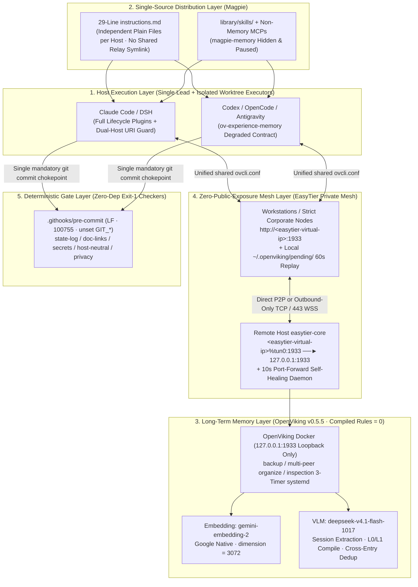

# Production Reference Stack

[简体中文](./REFERENCE-STACK.md) · **English**

> **Interactive Architecture Tour**: To visually trace the six-layer production flow, EasyTier encrypted mesh topology, OpenViking heterogeneous dual-model memory pipeline, and interactive positive-control gate lab, visit [**`https://abca12a.github.io/gate-first/?lang=en`**](https://abca12a.github.io/gate-first/?lang=en) or open [**`showcase/index.html`**](../showcase/index.html) locally in any browser.

The core `gate-first` contract is intentionally **zero-external-dependency**: with nothing more than `Git` and `Node.js >= 20`, you can stand up the complete minimal loop in 3 minutes—a 29-line global rule file, 10 host-neutral workflow skills, self-growing pre-commit gates, and pure-file memory templates.

Once you operate across multiple workstations (home desktop, corporate laptop, travel machine) while **driving 5 heterogeneous coding hosts across dozens of active repositories and generating millions of tool-trace tokens per day**, manual symlinks, ad-hoc SSH tunnels, and plain Markdown logs hit an operational ceiling. This document dissects the complete production stack running daily on top of `gate-first`: exact model specs, real sanitized configuration schemas, and the hard-won failure postmortems behind every safeguard.

---

## 1. Minimal Loop vs. Six-Layer Production Reference Stack

| Architecture Layer | 3-Minute Minimal Loop (Out of the Box) | Production Reference Stack (Multi-Machine · Multi-Host · Cross-Repo) | Core Failure Mode Eliminated |
|---|---|---|---|
| **1. Host Execution** | Any single coding agent (Claude Code / Codex / OpenCode / Antigravity, etc.) | **5 Coordinated Hosts** (Claude Code, Codex, DSH, OpenCode, Antigravity): Single Lead + `git worktree` isolated executors | Preserves architectural continuity while physically isolating parallel writers—zero half-written cross-contamination |
| **2. Asset Distribution** | Manually copy or symlink [`prompts/`](../prompts/README.md) and [`skills/`](../skills/) | **Magpie Single-Source Distributor**: one 29-line `instructions.md` + `library/skills/` + non-memory MCP registry driving all 5 hosts | Eliminates multi-host prompt drift, shared-relay symlink truncation wipes, and stale dangling skill links |
| **3. Long-Term Memory** | In-repo plain files [`memory/templates/`](../memory/templates/STATE.md) (`STATE.md` / `OPEN-ISSUES.md` / `LESSONS.md`) | **OpenViking `v0.5.5` Heterogeneous Dual-Model Engine**: `gemini-embedding-2` (3072d) + `deepseek-v4.1-flash-1017` (extraction/compilation) + unified `ovcli.conf` | Cross-session experience recall, strict repo-scoped auto-injection + cross-repo explicit lookup, 3-timer `systemd` ops |
| **4. Encrypted Mesh** | None required (local files only) | **EasyTier Zero-Public-Exposure Virtual Mesh**: container bound strictly to `127.0.0.1:1933` + `%tun0` user-space forward + 10s self-healing daemon + 60s local replay queue | Zero public port exposure for memory store, 2s workstation join, retires fragile `ssh -N -L` tunnels, corporate outbound-only compliant |
| **5. Deterministic Gates** | Git `core.hooksPath` ([`.githooks/pre-commit`](../gates/hooks/pre-commit)) running zero-dep Node checkers | **Git `pre-commit` Primary Gate** (LF + `100755` enforced) + optional **Stop Hook** with re-entry circuit breaker on lifecycle-capable hosts | 100% deterministic cross-host enforcement—no host can commit without passing the exact same non-zero exit bar |
| **6. Upstream Ecosystem** | 10 self-owned core governance skills bundled in this repo | **10 Self-Owned Core Governance Skills** + opt-in **upstream community companion skills** (debugging / domain modeling / frontend craft / experience recall) | Keeps core governance strictly host-neutral while composing best-in-class open-source domain skills |



---

## 2. EasyTier Zero-Public-Exposure Encrypted Virtual Mesh

A cross-session memory backend holds architectural facts, module boundaries, and full debugging histories across every repository—making it high-sensitivity engineering data. **Port `1933` must never be exposed on a public IP.**

### 2.1 Why We Replaced `ssh -N -L` Tunnels with an EasyTier Private Mesh

Earlier setups relied on boot-time `ssh -N -L 1933:127.0.0.1:1933` port-forwarding scripts to reach the remote memory server. Across daily multi-machine work, three chronic failure modes surfaced:

1. **Fragile across sleep/wake and network handoffs**: Closing a laptop lid, switching Wi-Fi/hotspots, or hitting carrier NAT timeouts routinely left zombie half-open SSH tunnels hanging for minutes, stalling memory plugin requests.
2. **High key-management friction**: Every new workstation or clean OS reinstall required provisioning restricted SSH jump accounts and per-machine authorized keys on the server.
3. **Rigid point-to-point topology**: Static SSH forwards do not scale naturally into resilient multi-node mesh routing.

Migrating to an **EasyTier private encrypted virtual mesh (`private_mode = true`, `dhcp = false`)** solved all three:

- Every workstation, restricted corporate laptop, and remote memory host sits on the same Layer-3 encrypted private subnet. Clients point uniformly to a fixed virtual address `http://<easytier-virtual-ip>:1933` (measured cross-city latency: `/health` ~ **`1.1s`**, semantic `recall` ~ **`0.8s`**).
- **2-second workstation onboarding**: No server SSH keys needed. Joining with the private `<network-name>` + `<network-secret>` and a statically assigned virtual IP (`dhcp = false` keeps endpoints deterministic) completes the encrypted handshake in **2 seconds**. Bootstrap peers configure dual `tcp://` and `wss://` relays so public IP rotation on either side never breaks connectivity.

### 2.2 Dual-Layer Server Isolation + 10-Second Port-Forward Self-Healing (Real Postmortem)

To eliminate public-port scanning and prevent container networking from silently bypassing host firewalls, the server enforces **loopback lock-down + TUN-scoped user-space forwarding**:

1. **Never bind Docker to `0.0.0.0`**: The OpenViking container maps strictly to host loopback `127.0.0.1:1933:1933`. Publishing `0.0.0.0:1933` causes Docker to inject rules straight into the kernel `DOCKER` chain, bypassing `ufw` / `firewalld` and exposing the port on public interfaces. Binding to `127.0.0.1` makes the container unreachable from physical NICs at the kernel level.
2. **Avoid brittle `iptables DNAT`—scope user-space forwarding strictly to `%tun0`**: Instead of maintaining fragile host `iptables DNAT` rules, `easytier-core` binds its native user-space port forward exclusively to the virtual TUN interface scope:
   ```text
   <easytier-virtual-ip>%tun0:1933  ──►  127.0.0.1:1933
   ```
   Public interfaces never even see a listening socket; only peers authenticated with `<network-secret>` inside the private mesh can reach the forwarder.
3. **Production Postmortem & 10-Second Self-Healing Daemon (`openviking-port-forward.service`)**:
   - **Incident**: After a routine `easytier.service` restart, mesh `ping` stayed healthy, yet every workstation hit `Connection refused` on `:1933`. Root cause: rules registered via `easytier-cli port-forward add` live **solely in daemon memory** and vanish silently on restart.
   - **Permanent Fix**: Deployed a dedicated `openviking-port-forward.service` unit that polls `easytier-cli port-forward list` every **10 seconds** and idempotently restores `<easytier-virtual-ip>%tun0:1933 -> 127.0.0.1:1933` the instant it goes missing.
   - **98.6% Disk Log Reduction**: At default `info` verbosity, `easytier-core` continuously dumps peer and route tables, burning cloud disk IOPS and storage. A `systemd` drop-in clamping log level to `warn` paired with `logrotate` (`maxsize 500M`) cut system log write volume by **`98.6%`**.

### 2.3 Adaptive P2P + Strict Outbound-Only Corporate Profile + 60-Second Local Replay Queue

- **Direct P2P on normal networks**: Home and standard broadband workstations automatically punch through for low-latency end-to-end encrypted P2P links.
- **Strict corporate outbound-only profile**: Behind enterprise firewalls that block inbound traffic, drop UDP, or flag anomalous probes (UPnP / QUIC / symmetric NAT scans), corporate laptops run a dedicated **quiet outbound-only template**—setting `listeners = []` and `disable_p2p = true`, explicitly disabling UDP/TCP/SYM hole-punching as well as KCP, QUIC, and UPnP LAN discovery, and relaying solely over standard outbound `TCP` or `443 WSS` channels without triggering security alerts.
- **Zero-block offline durability (`~/.openviking/pending/`)**: When laptop sleep, hotspot switches, or mesh re-handshakes cause transient unreachability, host memory plugins never block interactive coding—failed session commits serialize cleanly into `~/.openviking/pending/`. A background **60-second single-flight timer** probes `/health` first and invokes `replayPendingQueue` in order once the EasyTier link recovers.

---

## 3. OpenViking (`v0.5.5`) Long-Term Memory Engine & 6 Workflow Customizations

The long-term memory layer runs on **OpenViking `v0.5.5`**, strictly implementing the four-tier isolation and progressive disclosure contract defined in [`memory/CONTRACT.md`](../memory/CONTRACT.md).

### 3.1 Heterogeneous Dual-Model Architecture: `gemini-embedding-2` + `deepseek-v4.1-flash-1017`

| Responsibility | Production Model & Provider | Key Specs | Exact Workload |
|---|---|---|---|
| **Embedding Model** | **`gemini-embedding-2`**<br>(Google Native Provider) | `dimension = 3072` | Builds high-dimensional dense vectors across all structured memory namespaces (`preferences`, `entities`, `events`, `cases`, `experiences`) and static long-form archives under `resources/`, handling mixed Chinese/English prose, code symbols, and stack traces with high recall fidelity. |
| **VLM / Semantic Compiler** | **`deepseek-v4.1-flash-1017`**<br>(OpenAI-Compatible API) | High throughput, low latency, strong technical summarization | Runs three asynchronous background jobs:<br>1. **Session-close extraction**: distills structured memory entries from conversations and captured `ToolParts`;<br>2. **Three-tier disclosure compilation**: compiles **L0 (`.abstract.md` one-line dense index)** and **L1 (`.overview.md` structured summary)** alongside **L2 (full body)**;<br>3. **Scheduled consolidation**: executes daily `compile memory` dedup and in-place merging on the server. |

- **Dual-Track Ingestion (`processing_mode`)**: Active evolving memories use **`semantic_and_vectors`** (3072d vectors + VLM L0/L1 compilation). Bulk-imported static reference docs use **`vectors_only`** (3072d embeddings via `gemini-embedding-2` only, skipping VLM summarization to eliminate unnecessary token burn—verified during historical migration: **27** structured memories via `semantic_and_vectors` vs. **47** archived long-form docs via `vectors_only`).
- **Orthogonal Decoupling Payoff**: Earlier configurations placed the VLM on `gemini-3.8-flash` inside the same quota pool as embeddings, causing heavy session closeouts to contend with live recall. Moving VLM workloads to `deepseek-v4.1-flash-1017` dedicates 100% of Google native quota to 3072d retrieval—**and because vector coordinates depend exclusively on the embedding model, swapping the VLM required zero vector recomputation and zero downtime**.

---

### 3.2 Unified Client Control Plane: Real Nested `ovcli.conf` Schema & Precedence

Every host on the workstation reads the same `~/.openviking/ovcli.conf`. OpenViking `v0.5.5` uses a **top-level connection identity + nested `"plugin"` policy block** (sanitized below):

```json
{
  "url": "http://<easytier-virtual-ip>:1933",
  "api_key": "<redacted-user-key>",
  "account": "default",
  "user": "default",
  "plugin": {
    "recallPeerScope": "actor",
    "commitTokenThreshold": 60000,
    "commitTurnThreshold": 20,
    "captureToolResults": true,
    "captureToolMaxChars": 12000,
    "skipSubagentSessions": true
  }
}
```

- **Control-plane precedence**: In OpenViking's client plugin implementation, keys inside `ovcli.conf`'s nested `"plugin"` object **override** per-host local plugin arguments. Instead of editing separate plugin configs for Claude Code, DSH, and other hosts, **one edit in `ovcli.conf` atomically updates repo isolation scope, commit watermarks (`60000` tokens / `20` turns), `ToolParts` truncation cap (`12000` chars), and subagent write blocking across the entire machine**.

---

### 3.3 Two-Tier Multi-Host Wiring & Dual-Host `URI Guard`

1. **Tier 1: Full Lifecycle Hosts (Claude Code + DSH)**
   - **Claude Code**: Loads `openviking-memory` covering all **9 lifecycle hooks** (`SessionStart`, `UserPromptSubmit`, `PreToolUse`, `PostToolUse`, `Stop`, `PreCompact`, `SessionEnd`, `SubagentStart`, `SubagentStop`).
   - **DSH**: Loads the native `@openviking/dsh-memory-plugin` lifecycle integration.
   - **Dual-Host Built-In `URI Guard` (blocks local file tools on `viking://`)**: Claude Code wires `uri-guard.mjs` into `PreToolUse` (intercepting accidental `Read|Glob|Grep|Edit|Write|Bash` calls targeting `viking://`), and DSH enforces the same `URI Guard` inside its native plugin. Whenever a model mistakes `viking://~/...` for a local disk path, execution halts immediately before the tool fires and redirects the agent to OpenViking's `read` API—eliminating wasted error turns.
   - **CJK-Aware Boot Profile Assembly**: `SessionStart` budgets `<openviking-context source="profile">` at `1.5 tokens / CJK char`, loading global `profile.md` + `preferences/` + `entities/` first and filling remaining budget with the active repository's `peer` summary.
2. **Tier 2: Lightweight or Generic Hosts (Codex / OpenCode / Antigravity, etc.)**
   - Driven by the ~30-line global prompt pointer + `ov-experience-memory` skill: during executable tasks or debugging, agents query `viking://~/memories/experiences` via `find`/`search` (`limit=5`), screen 1–3 candidates via L0/L1, and call `read` to verify full L2 bodies before acting. When memory tools are absent, hosts degrade gracefully without fabricating tool calls.

---

### 3.4 Four Deep Customizations Tailored for `gate-first`

Stock defaults target single-repo chat workflows. Supporting `gate-first`'s **multi-host + multi-repo + single-lead** model required four deliberate production customizations:

#### Customization A · Strict Jurisdiction Split Between Magpie and OpenViking
- **Forbid shipping raw `uvx ... openviking` via Magpie's MCP table**: Broadcasting a raw `uvx` MCP globally via Magpie caused hanging `Initialize` handshakes and spawned duplicate stdio bridge clashes against the built-in MCP proxies bundled in Claude Code and DSH native plugins.
- **Silence `magpie-memory` completely**: Mark Magpie's built-in lightweight memory module `hidden: true` and `paused` across all hosts. Iron rule: **Magpie owns static instructions, skills, and non-memory tool MCPs only; cross-session memory belongs 100% to native host plugins + unified `ovcli.conf`**. Simultaneously keep OpenViking server `Compiled Rules = 0` to prevent two-source behavioral drift against in-repo `AGENTS.md`.

#### Customization B · Dual-Track `recallPeerScope: "actor"` (Scoped Auto-Isolation vs. Cross-Repo Explicit Search)
- **Strict automatic isolation**: Lifecycle hooks attach `X-OpenViking-Actor-Peer` during boot injection and session capture, locking repo facts strictly inside the Git-derived `peers/<actor>/memories/` namespace so unrelated repositories never bleed into each other.
- **Cross-repo explicit lookup**: The resident built-in stdio MCP proxy **intentionally leaves global `actor_peer_id` unpinned**. When an agent hits a gnarly failure and explicitly runs `search` / `find`, it searches across every historical repository `peer` and global `experiences/`—delivering zero bleed during normal work and full cross-project recall during troubleshooting.
- **Scratch-directory `peer` hygiene**: Because `actor` derives from the working directory's Git identity, launching ad-hoc sessions inside non-Git scratch folders creates stray misc `peer` buckets; periodic audits prune and merge these so `peers/` stays 1:1 with real repositories.

#### Customization C · Server-Side 3-Timer `systemd` Autonomous Operations (Multi-Peer Ready)
Three decoupled `systemd` timers keep the memory server self-maintaining without human babysitting:
1. **`backup.timer` (snapshots & rolling archives)**: Retains **14-day** rolling backups. Operational red line: before any manual bulk edit or cleanup, run `openviking snapshot commit` first and log the deterministic rollback `OID`.
2. **`organize.timer` (full `peers/*` coverage patch)**: Upstream's stock organize script scans only top-level global `memories/`, ignoring every repository namespace created under `peers/<actor>/` when `recallPeerScope: "actor"` is active. Production runs a customized `openviking-daily-organize.sh` that **enumerates and iterates across every active `peers/*` namespace**, taking a per-peer snapshot before running `openviking compile memory` under independent timeout and fault isolation (one broken repo never stalls the rest).
3. **`inspection.timer` (self-logged daily health reports)**: Daily automated checks verify Docker container liveness, `/health`, `/bot/v1/health`, `openviking doctor`, backup freshness, and error-log digests, then call `openviking write` to archive the report directly into `resources/ops/reports/openviking-daily-YYYY-MM-DD.md`—consuming **`0` always-loaded boot tokens** while staying instantly searchable whenever an agent investigates a memory outage.

#### Customization D · Companion `vikingbot` (`--with-bot`) `memories/soul.md` Persona Alignment & Migration Boundaries
- **Cross-surface persona alignment (`memories/soul.md`)**: Desktop coding host plugins ignore `soul.md`, but the server-side companion `vikingbot` (`--with-bot` remote chat interface) loads it as its core persona. Rewriting `memories/soul.md` to mirror the 29-line global rule contract enforces the same engineering discipline everywhere: **lead with conclusions, stay concise, verify evidence before claiming facts, and confirm before external writes**.
- **Code-is-truth migration pruning & two `openviking batch-write` gotchas**:
  - During migration from legacy notes, **all stale `STATE` progress snapshots derived from repository docs were deliberately dropped** (live code and in-repo `docs/STATE.md` are the sole truth; importing old progress creates temporal hallucinations). The curated import landed cleanly at **27** structured memories (`semantic_and_vectors`) and **47** static reference archives (`vectors_only`).
  - Two hard runtime boundaries uncovered on **`openviking batch-write`**: (1) `root_uri` must point to an exact, pre-created leaf directory (e.g., `memories/entities`)—passing a parent root or nonexistent path fails outright; (2) metadata `tags` **only parse `k=v` equals syntax**—writing `k:v` with colons is silently dropped without raising an error!

---

## 4. Magpie Single-Source Cross-Host Distribution & Two Classic Filesystem Traps

Running **Claude Code, Codex, DSH, OpenCode, and Antigravity** simultaneously, production relies on **Magpie** to manage one 29-line `instructions.md` and `library/skills/` library while sealing two subtle filesystem hazards (guarded by [`skills/skill-maintenance/`](../skills/skill-maintenance/SKILL.md)):

### Production Trap 1: 3 Hosts Symlinking Global Rules to One Shared Relay -> 0-Byte Truncation Wipe

- **Postmortem**: To keep 3 hosts' global instruction files (`~/.claude/CLAUDE.md`, `~/.codex/AGENTS.md`, etc.) synchronized, all 3 paths were originally symlinked to **one shared relay file (`~/.agents/AGENTS.md`)**. When the distributor updated each host sequentially using truncating writes (`O_TRUNC`), all 3 passes raced on the exact same underlying inode and wiped `~/.agents/AGENTS.md` down to **`0` bytes**—instantly blanking global rules across all 3 hosts while exiting `0`.
- **Engineering Law**: Skill directories may use read-only directory symlinks, but **every host's global instruction file must be an independent regular file** updated via hash-delimited managed blocks (`<!-- magpie:begin -->` ... `<!-- magpie:end -->`)—never symlink multiple host rule files onto one shared relay.

### Production Trap 2: 33 Dangling Symlinks Passing Naive Existence Checks ("Fake Green")

- **Postmortem**: After consolidating and retiring duplicate skills, one host's `skills/` directory retained **33 dangling symlinks pointing at deleted directories**. Naive path-existence checks saw the symlink directory entry and reported all green; the host booted without errors and silently dropped those skills.
- **Engineering Law**: [`check-host-skills.mjs`](../skills/skill-maintenance/scripts/check-host-skills.mjs) inspects entries with `fs.lstatSync` first and then calls **`fs.statSync` to force target resolution**—any missing target throws `ENOENT`, immediately flagging `BROKEN_LINK` and exiting `1` (see [`magpie-adapter.md`](../skills/skill-maintenance/references/magpie-adapter.md)).

---

## 5. Recommended Upstream Community Companion Skills (Honest Attribution, Opt-In)

`gate-first` bundles only original, fully sanitized, host-neutral governance assets (**10 core workflow & lifecycle skills**). In daily full-stack engineering, they compose cleanly with these proven open-source upstream skills (install directly from their respective upstream repositories):

| Upstream Repository | Recommended Skills | License | Complementary Role in This Workflow |
|---|---|---|---|
| **[`mattpocock/skills`](https://github.com/mattpocock/skills)** | `diagnosing-bugs`<br>`domain-modeling`<br>`grill-with-docs`<br>`handoff`<br>`writing-for-agents` | `MIT` | • **Ad-hoc bug diagnosis**: hypothesis-driven root-cause loop for runtime failures without an audit list (complements our `audit-fix-loop`);<br>• **Pre-code alignment & modeling**: relentless design interrogation (`grill-with-docs`) and ubiquitous language / ADR modeling (`domain-modeling`);<br>• **Agent documentation craft**: concise context-pointer writing (`writing-for-agents`) and session handoffs. |
| **[`leonxlnx/taste-skill`](https://github.com/leonxlnx/taste-skill)** | `design-taste-frontend` | `MIT` | • **Greenfield anti-slop UI engineering**: eliminates generic "AI template" layouts through unified grids, editorial typography, and restrained micro-interactions. |
| **[`pbakaus/impeccable`](https://github.com/pbakaus/impeccable)** | `impeccable` | `Apache-2.0` | • **Existing UI audit, polish & hardening**: refines visual hierarchy, WCAG contrast, responsive boundaries, and empty/error states on existing interfaces. |
| **[`volcengine/openviking`](https://github.com/volcengine/openviking)** | `ov-experience-memory` | `Apache-2.0` | • **Lightweight host experience bridge**: enforces L0/L1 candidate screening + mandatory L2 full-body verification against `viking://~/memories/experiences` on hosts without native lifecycle plugins. |

---

## 6. Progressive Adoption Roadmap: Add Layers Only When Pain Is Real

1. **Day 1 (3-Minute Zero-Dependency Start)**: Run `node scaffold/init-project.mjs <your-repo>`, wire `.githooks/pre-commit` (stage with `git add --chmod=+x` to guarantee Git index mode `100755`), copy Variant A of the global prompt, and mount the 10 core skills. Lock down deterministic commit-time gates first.
2. **Week 2 (Multi-Host Sync Phase)**: Once you split daily work across Claude Code, Codex, and sibling hosts, introduce Magpie (strictly independent regular files with managed blocks—never shared-relay symlinks) and guard link health with `check-host-skills.mjs`.
3. **Month 1+ (Multi-Machine Encrypted Cross-Repo Memory)**: When working across home and corporate machines and troubleshooting history outgrows plain Markdown, bring up an **EasyTier** zero-public-exposure mesh (container on `127.0.0.1:1933` + `%tun0` 10s self-healing forwarder), deploy **OpenViking `v0.5.5`** (`gemini-embedding-2` 3072d + `deepseek-v4.1-flash-1017` + unified nested `ovcli.conf` + multi-`peer` daily organize), and switch to Variant B of the global prompt.
