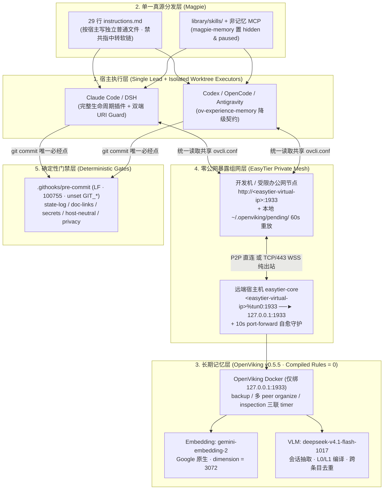

# 生产参考全栈白皮书（Production Reference Stack）

**简体中文** · [English](./REFERENCE-STACK.en.md)

> **交互式全景导览**：想直观查看本白皮书描述的六层生产架构流转、EasyTier 加密组网拓扑、OpenViking 异构双模型记忆流水线与门禁阳性对照实验，可直接在线访问 👉 [**`https://abca12a.github.io/gate-first/?lang=zh`**](https://abca12a.github.io/gate-first/?lang=zh)，或在本地浏览器打开 [**`showcase/index.html`**](../showcase/index.html)。

`gate-first` 的基础契约刻意做到了**零外部服务依赖**：只要机器上有 `Git` 和 `Node.js >= 20`，你就能在 3 分钟内跑起「29 行全局规则 + 10 个核心工作流 Skill + 提交前自增长门禁 + 纯文件记忆模板」的完整最小闭环。

但当你在多台主力机器（家里开发机、公司办公电脑、笔记本）之间切换，**同时驱动 5 个异构编码宿主、跨数十个仓库并行演进、每天产生上百万 Token 工具调用轨迹**时，纯手工维护符号链接、SSH 端口转发和纯文件记忆会迅速撞上运维天花板。本文完整拆解作者在真实生产环境中长期运行的配套全栈架构、具体模型规格、真实配置文件结构与排障复盘。

---

## 一、最小可用闭环 vs 六层生产参考全栈

| 架构层次 | 3 分钟最小闭环（本仓开箱即用） | 作者生产全栈（多机 · 多宿主 · 跨仓协同） | 解决的核心痛点 |
|---|---|---|---|
| **1. 宿主执行层** | 任意单一编码 Agent（Claude Code / Codex / OpenCode / Antigravity 等） | **5 宿主协同**（Claude Code、Codex、DSH、OpenCode、Antigravity）：唯一主导 + `git worktree` 隔离执行者 | 兼顾架构上下文连贯性与多写者物理隔离，杜绝半成品互踩 |
| **2. 资产分发层** | 手工复制或软链 [`prompts/`](../prompts/README.md) 与 [`skills/`](../skills/) | **Magpie 单一真源分发器**：一份 29 行 `instructions.md` + `library/skills/` + 非记忆类 MCP 注册表驱动 5 宿主 | 根治多宿主规则副本漂移、共享软链踩踏归零与下架残留悬空链 |
| **3. 长期记忆层** | 仓内纯文件 [`memory/templates/`](../memory/templates/STATE.md)（`STATE.md` / `OPEN-ISSUES.md` / `LESSONS.md`） | **OpenViking `v0.5.5` 异构双模型引擎**：`gemini-embedding-2`（3072 维）+ `deepseek-v4.1-flash-1017`（抽取/编译）+ 共享 `ovcli.conf` | 跨会话经验召回、自动注入按仓隔离 + 主动搜索跨仓借鉴、三联 `systemd` 自动运维 |
| **4. 加密组网层** | 无需网络（纯本地文件） | **EasyTier 零公网暴露虚拟内网**：容器仅绑 `127.0.0.1:1933` + `%tun0` 作用域转发 + 10 秒自愈守护 + 60 秒本地离线重放队列 | 记忆库零公网端口暴露，多开发机 2 秒入网，淘汰易断连的 `ssh -N -L` 跳板，兼容严苛办公网纯出站 |
| **5. 门禁拦截层** | Git `core.hooksPath`（[`.githooks/pre-commit`](../gates/hooks/pre-commit)）跑零依赖 Node 检查器 | **Git `pre-commit` 主关卡**（LF + `100755` 强约束）+ 支持生命周期宿主的 **可选 Stop Hook**（重入熔断） | 跨宿主 100% 确定性拦截，任何宿主提交都绕不开同一套非零退出判据 |
| **6. 上游生态层** | 本仓自持的 10 个核心工程治理 Skill | **10 个自持核心治理 Skill** + 按需挂载的 **上游社区专项 Skill**（调试 / 领域建模 / 前端审美 / 经验检索） | 核心治理严守宿主中立，专业领域直接复用社区最成熟的开源资产 |



---

## 二、EasyTier 零公网暴露加密虚拟内网层

跨会话记忆库存储着所有项目的架构事实、模块边界与完整排障轨迹，属于最高敏感度研发资产，**绝对不能把 `1933` 端口直接暴露在公网 IP 上**。

### 2.1 为什么淘汰 `ssh -N -L` 跳板隧道，改用 EasyTier 私有网格

早期曾用开机自启脚本跑 `ssh -N -L 1933:127.0.0.1:1933` 端口转发连接远端记忆服务端，在实际多机办公中暴露了三大顽疾：
1. **休眠唤醒与切网脆弱**：笔记本合盖休眠、Wi-Fi 切换或运营商 NAT 会话超时后，SSH 僵尸连接经常卡死数分钟才超时重连，期间记忆插件请求直接挂起；
2. **多机密钥分发繁琐**：每增加一台办公机或重装环境，都要单独配置服务器 SSH 跳板受限账号与密钥授权；
3. **跨节点互访僵化**：点对点隧道无法自然扩展多节点网格路由。

切换至 **EasyTier 私有加密虚拟内网（`private_mode = true`, `dhcp = false`）** 后：
- 所有开发机、受限办公电脑与远端记忆宿主机共处同一三层加密虚拟子网，客户端配置统一填写固定虚拟内网地址 `http://<easytier-virtual-ip>:1933`（跨城实测：`/health` 探活约 **`1.1s`**，语义 `recall` 约 **`0.8s`**）；
- **新开发机 2 秒闪电入网**：无需分发服务器 SSH 私钥，仅凭私有 `<network-name>` + `<network-secret>` 并静态声明本机虚拟 IP（`dhcp = false` 保证地址恒定可预期），**2 秒内即可完成加密握手入网**；引导节点同时配置 `tcp://` 与 `wss://` 双协议中继冗余，任何一端更换公网 IP 均不破网。

### 2.2 服务端双层隔离绑定 + 10 秒端口转发自愈守护（真实生产踩坑）

为了从根源上封死公网扫描与容器网络绕过防火墙的可能，服务端采取**「回环死锁 + 虚拟网卡作用域用户态转发」**双保险：

1. **Docker 容器严禁绑 `0.0.0.0`**：OpenViking 容器端口映射严格写死为宿主机回环 `127.0.0.1:1933:1933`。众所周知，Docker 若映射 `0.0.0.0:1933` 会直接在内核 `DOCKER` 链注入规则，绕过宿主机 `ufw` / `firewalld` 把端口裸露到公网网卡；绑死 `127.0.0.1` 后物理网卡在内核层彻底不可达。
2. **不碰内核 `iptables DNAT`，限定 `%tun0` 虚拟接口用户态转发**：不在宿主机维护脆弱的内核 `iptables DNAT` 规则，改由 `easytier-core` 原生用户态端口转发，将监听严格钉在虚拟网卡接口作用域：
   ```text
   <easytier-virtual-ip>%tun0:1933  ──►  127.0.0.1:1933
   ```
   公网物理网卡连监听套接字都看不到，只有通过 `<network-secret>` 认证进入虚拟网格的节点才能访问。
3. **踩坑与 10 秒自愈守护（`openviking-port-forward.service`）**：
   - **真实事故**：上线后某次 `easytier.service` 重启，虚拟网 `ping` 完全正常，但所有开发机连 `:1933` 全部 `Connection refused`。排查发现 `easytier-cli port-forward add` 写入的是**守护进程内存态规则**，进程一重启转发项就静默清零！
   - **根治方案**：额外部署独立的 `openviking-port-forward.service` 守护单元，每 **10 秒**轮询一次 `easytier-cli port-forward list`，一旦检测到 `<easytier-virtual-ip>%tun0:1933 -> 127.0.0.1:1933` 缺失立即幂等补回。
   - **日志刷盘降噪（直降 `98.6%`）**：`easytier-core` 默认 `info` 级别会高频周期性 dump 路由与 peer 状态表，长期运行大量消耗云盘写 IOPS 与容量。通过 `systemd` drop-in 覆写将日志级别压至 `warn` 并配合 `logrotate`（`maxsize 500M`），实测系统日志写入量直接下降 **`98.6%`**。

### 2.3 P2P 直连 + 严苛办公网纯出站双模 + 60 秒本地离线重放闭环

- **常规网络自动 P2P 直连**：家庭与普通宽带节点自动打洞建立端到端加密直连，延迟最低。
- **严苛企业办公网纯出站模板**：面对禁入站、禁 UDP、甚至审计异常探测包（UPnP / QUIC / 对称 NAT 扫描）的企业防火墙，办公电脑采用专用的**静默纯出站配置模板**——设置 `listeners = []`、`disable_p2p = true`，显式关闭 UDP/TCP/SYM 打洞以及 KCP、QUIC、UPnP 局域网探测，仅复用普通出站 `TCP` 或 `443 WSS` 加密通道中继流量，不触发内网安全告警即可稳定连回记忆库。
- **断网零阻塞闭环（`~/.openviking/pending/`）**：当笔记本合盖休眠、切热点或虚拟网卡重握手导致瞬时不可达时，客户端记忆插件绝不阻塞前台对话——提交失败的会话载荷自动序列化落入本机 `~/.openviking/pending/` 离线队列；后台 **60 秒单飞（single-flight）定时器**每次先轻量探测 `/health`，确认 EasyTier 链路恢复后再调用 `replayPendingQueue` 按序无损补交。

---

## 三、OpenViking（`v0.5.5`）长期记忆引擎与 6 项工作流专属定制

长期记忆层由 **OpenViking `v0.5.5`** 驱动，严格实现 [`memory/CONTRACT.md`](../memory/CONTRACT.md) 的四层隔离与渐进披露契约。

### 3.1 异构双模型架构：为什么拆成 `gemini-embedding-2` + `deepseek-v4.1-flash-1017`

| 职责维度 | 生产选型与接入方式 | 关键规格参数 | 承担的具体工作负载 |
|---|---|---|---|
| **Embedding 向量模型** | **`gemini-embedding-2`**<br>（Google 原生 Provider） | `dimension = 3072` | 承担全库结构化记忆（`preferences` / `entities` / `events` / `cases` / `experiences`）与 `resources/` 长技术归档的高维稠密向量编码，支撑中英混合、代码标识符、错误码与自然语言混排的高精度语义检索。 |
| **VLM / 语义编译模型** | **`deepseek-v4.1-flash-1017`**<br>（OpenAI 兼容接口） | 高吞吐、低延迟、强中文工程归纳 | 承担三项后台重活：<br>① **会话收尾抽取**：在会话结束或上下文压缩前，从对话与工具轨迹（`ToolParts`）中提炼结构化记忆；<br>② **三层披露编译**：入库时编译 **L0（`.abstract.md` 一句话高密度索引）** 与 **L1（`.overview.md` 结构化概览）**，配合 **L2（原始正文）** 构成渐进披露；<br>③ **定时整理合并**：服务端每日定时执行 `compile memory` 跨条目去重归并。 |

- **入库双轨制（`processing_mode`）**：日常高频演进记忆走 **`semantic_and_vectors`**（建 `3072` 维向量 + 调 VLM 编译 L0/L1）；批量迁入静态长资料走 **`vectors_only`**（仅调 `gemini-embedding-2` 建向量，跳过 VLM 摘要编译大幅省成本——历史迁移实测：**27 条**结构化记忆走 `semantic_and_vectors`，**47 篇**历史长文档归档显式走 `vectors_only`）。
- **解耦演进红利**：早期曾将 VLM 也配在同配额池的 `gemini-3.8-flash` 上，导致后台密集抽取编译与前台实时 Embedding 争抢同一速率池；切至 `deepseek-v4.1-flash-1017` 后，Google 原生配额 100% 专供 `3072` 维向量——**且因向量层与语义编译层彻底正交，切换 VLM 无需重算任何既有向量索引（零停机迁移）**。

---

### 3.2 统一客户端控制面：`ovcli.conf` 真实嵌套 Schema 与优先级链

所有本机宿主统一读取 `~/.openviking/ovcli.conf`。OpenViking `v0.5.5` 的真实配置采用**顶层连接身份 + 嵌套 `"plugin"` 策略对象**结构（下方已做严格脱敏）：

```json
{
  "url": "http://<easytier-virtual-ip>:1933",
  "api_key": "<redacted-user-key>",
  "account": "default",
  "user": "default",
  "plugin": {
    "recallPeerScope": "actor",
    "commitTokenThreshold": 60000,
    "commitTurnThreshold": 20,
    "captureToolResults": true,
    "captureToolMaxChars": 12000,
    "skipSubagentSessions": true
  }
}
```

- **源码级优先级优势**：在 OpenViking 客户端插件实现中，`ovcli.conf` 内嵌 `"plugin"` 段的字段优先级**高于**单宿主本地插件启动入参。这意味着无需去 Claude Code、DSH 等宿主目录逐个改插件配置——**只改一处 `ovcli.conf`，全机所有宿主的隔离作用域、水位线（`60000` tokens / `20` 轮）、`ToolParts` 截断上限（`12000` 字符）与子代理禁写开关同步生效**。

---

### 3.3 多宿主两档接线与双宿主 `URI Guard`

1. **第一档：完整生命周期宿主（Claude Code + DSH）**
   - **Claude Code**：挂载 `openviking-memory` 插件，接管全部 **9 个生命周期 Hook**（`SessionStart` / `UserPromptSubmit` / `PreToolUse` / `PostToolUse` / `Stop` / `PreCompact` / `SessionEnd` / `SubagentStart` / `SubagentStop`）。
   - **DSH**：挂载原生 `@openviking/dsh-memory-plugin` 生命周期插件。
   - **双宿主均内置 `URI Guard`（`viking://` 本地文件工具误读拦截）**：Claude Code 在 `PreToolUse` 挂载 `uri-guard.mjs`（拦截 `Read|Glob|Grep|Edit|Write|Bash` 对 `viking://` 的误调用），DSH 在原生插件内同样内置 `URI Guard`——一旦模型试图用本地磁盘工具去读 `viking://~/...` 虚拟 URI，立即在工具执行前精准阻断并提示改调 OpenViking `read` 接口，避免白白浪费报错轮次。
   - **CJK 感知画像组装**：`SessionStart` 按中文 `1.5 token / 字` 预算组装 `<openviking-context source="profile">`，先装全局 `profile.md` + `preferences/` + `entities/`，剩余预算再装当前仓库 `peer` 摘要。
2. **第二档：轻量或通用宿主（Codex / OpenCode / Antigravity 等）**
   - 由全局规则指针 + `ov-experience-memory` Skill 驱动：在可执行任务或排障时限定 `viking://~/memories/experiences` 调 `find`/`search`（`limit=5`），据 L0/L1 选 1–3 条后强制调 `read` 展开 L2 原文核实；未挂载工具时优雅跳过，严禁伪造调用。

---

### 3.4 专门配套 `gate-first` 的 4 项深度定制设定

原厂默认配置面向通用单仓库聊天场景；为支撑本工作流的「多宿主 + 多仓库 + 唯一主导」模型，生产环境落地了四项关键定制：

#### 定制 A · Magpie 与 OpenViking 的严格管辖切割
- **禁止在 Magpie MCP 表下发裸 `uvx ... openviking`**：实测通过 Magpie 全局广播裸 `uvx` MCP 会出现 `Initialize` 握手无响应，还会与 Claude Code / DSH 原生插件自带的内置 stdio MCP 桥接代理发生双实例冲突。
- **彻底静默 `magpie-memory`**：将 Magpie 内置的简易记忆模块设为 `hidden: true` 并在全部宿主标记为 `paused`。铁律：**Magpie 只管静态指令/Skill/普通工具 MCP 分发；跨会话记忆 100% 归宿主插件 + 共享 `ovcli.conf` 统管**；同时保持 OpenViking 服务端 `Compiled Rules = 0`，杜绝与仓内 `AGENTS.md` 双源漂移。

#### 定制 B · `recallPeerScope: "actor"` 的「自动注入按仓严隔 vs 主动检索跨仓借鉴」双轨机制
- **自动通道严隔**：生命周期 Hook 在开场画像注入与收尾自动捕获时，显式携带 `X-OpenViking-Actor-Peer` 请求头，把项目事实严格锁死在当前 Git 仓库派生的 `peers/<actor>/memories/` 空间内，彻底根除跨项目上下文串味。
- **主动通道跨仓共享**：常驻的内置 stdio MCP 桥接代理**刻意不锁死全局固定 `actor_peer_id`**——当 Agent 遇到棘手故障主动调用 `search` / `find` 检索时，视野天然横跨全部历史项目 `peer` 与全局 `experiences/`，实现「平时互不干扰，排障博采众长」。
- **杂项 `peer` 卫生治理**：由于 `actor` 依据工作目录 Git 身份派生，若偶尔在无 Git 远端的临时草稿目录启动会话，会衍生出零散杂项 `peer` 桶；日常通过巡检定期归并清理，保持 `peers/` 命名空间与真实仓库一一对应。

#### 定制 C · 服务端每日三联 `systemd` 自动化运维改造（适配多项目 `peers/`）
服务端通过三个解耦的 `systemd timer` 实现无人值守自维护：
1. **`backup.timer`（快照与滚动备份）**：保留 **14 天**滚动归档；并立下运维红线——任何人工批量改库或清理前，必须先执行 `openviking snapshot commit` 拿到确定性回滚 `OID` 落盘备查。
2. **`organize.timer`（多项目 `peers/` 全覆盖编译改造）**：OpenViking 原厂默认整理脚本只扫描顶层全局 `memories/`，对 `recallPeerScope: "actor"` 模式下散落在 `peers/<actor>/` 里的各仓库记忆视而不见。生产环境专门改造了 `openviking-daily-organize.sh`，使其**自动枚举并遍历 `peers/` 下全部活跃项目空间**，逐仓先打快照再调 `openviking compile memory`，且为每个 `peer` 设独立超时与容错隔离（单仓异常绝不阻断其余仓库整理）。
3. **`inspection.timer`（每日巡检日报自举入库）**：每日自动核查 Docker 容器存活、`/health`、`/bot/v1/health`、`openviking doctor`、备份新鲜度与错误日志摘要，随后直接调用 `openviking write` 将巡检报告写入 `resources/ops/reports/openviking-daily-YYYY-MM-DD.md`——**平时占 `0` 个常驻上下文 Token**，一旦怀疑记忆服务异常，Agent 直接语义搜索 `resources/ops/reports` 即可调阅历史健康曲线。

#### 定制 D · 伴生 `vikingbot` (`--with-bot`) 的 `memories/soul.md` 人设对齐与迁移硬边界
- **`memories/soul.md` 跨端人设对齐**：各桌面编码宿主插件均不读取 `soul.md`，唯独服务端伴生启动的 `vikingbot`（`--with-bot` 远程对话机器人入口）将其作为核心人设加载。为此专门将 `memories/soul.md` 改写为与 29 行全局规则同构的中文工程准则：**结论前置、直白简洁、先查证据再下判断、任何外部写入前必须先获确认**。
- **「仓内真值优先」迁移裁剪与 `batch-write` 两条防坑边界**：
  - 从旧笔记迁入 OpenViking 时，**主动丢弃所有由代码仓文档派生的过期 `STATE` 进度快照**（代码与仓内 `docs/STATE.md` 才是唯一真值，迁入旧进度只会制造时空错乱），最终精炼迁入 **27 条**高价值结构化记忆（`semantic_and_vectors`）与 **47 篇**长参考归档（`vectors_only`）。
  - 实测踩出的 **`openviking batch-write` 两条硬边界**：① `root_uri` 必须精确指向已预建的具体叶子子目录（如 `memories/entities`），传父级根路径或未预建目录会直接写入失败；② 元数据 `tags` 参数**只认 `k=v` 等号格式**，若写成 `k:v` 冒号格式会被静默丢弃且不报错！

---

## 四、Magpie 跨宿主单一真源分发与两个经典陷阱

同时主力使用 **Claude Code、Codex、DSH、OpenCode、Antigravity** 5 个宿主时，生产环境用 **Magpie** 统一维护一份 29 行 `instructions.md` 与 `library/skills/`，并封死了两个极具隐蔽性的文件系统陷阱（对应检查器见 [`skills/skill-maintenance/`](../skills/skill-maintenance/SKILL.md)）：

### 真实工程坑 1：3 个宿主全局规则软链共指同一共享中转文件 → 覆写踩踏归零

- **事故回放**：早期为了让 3 个宿主的全局规则（`~/.claude/CLAUDE.md`、`~/.codex/AGENTS.md` 等）实时保持一致，曾将这 3 个目标路径全部建为符号链接，**共同指向同一个共享中转文件 `~/.agents/AGENTS.md`**。当分发器按宿主顺序依次以截断写（`O_TRUNC`）打开目标路径更新受管块时，3 个通道在底层直接踩踏同一个文件 inode，当场把 `~/.agents/AGENTS.md` 截断清空成 **`0` 字节**——导致 3 个宿主的全局规则瞬间同时归零，而同步命令退出码仍是 `0`。
- **工程铁律**：`skills/` 目录可以用只读目录软链；**各宿主的全局规则文件必须是彼此独立的普通文件（Regular File），严禁多宿主软链共指同一共享中转文件**，由分发器分别写入带哈希起止标记（`<!-- magpie:begin -->` ... `<!-- magpie:end -->`）的受管块。

### 真实工程坑 2：技能合并下架后残留 33 条悬空软链，普通存在性检查报「全绿」

- **事故回放**：精简合并技能库后，某宿主的 `skills/` 目录留下了 **33 条指向已删除实体的符号链接**。普通「路径是否存在」函数因链接目录项仍在而全部返回存在（假绿），宿主启动也不报错，只是静默丢技能。
- **工程铁律**：[`check-host-skills.mjs`](../skills/skill-maintenance/scripts/check-host-skills.mjs) 一律先 `fs.lstatSync` 识别软链，再用 **`fs.statSync` 强制穿透目标**——目标缺失必抛 `ENOENT`，当场标红 `BROKEN_LINK` 并退出 `1`（详见 [`magpie-adapter.md`](../skills/skill-maintenance/references/magpie-adapter.md)）。

---

## 五、推荐搭配的上游社区 Skill 清单（诚实归属，按需选装）

`gate-first` 只在仓库内内置原创沉淀、完全脱敏且宿主中立的 **10 个核心工程治理与生命周期 Skill**。在日常全栈研发中，它们与以下开源社区优秀专项 Skill 形成严密互补（推荐直接从各上游仓库按需安装）：

| 上游仓库 | 推荐搭配的 Skill | 许可证 | 在本工作流中的互补环节 |
|---|---|---|---|
| **[`mattpocock/skills`](https://github.com/mattpocock/skills)** | `diagnosing-bugs`<br>`domain-modeling`<br>`grill-with-docs`<br>`handoff`<br>`writing-for-agents` | `MIT` | • **日常疑难排障**：无现成审计单的硬核 bug 科学假设验证循环（与本仓处理外部审计清单的 `audit-fix-loop` 精准互补）；<br>• **编码前对齐与建模**：高歧义需求深度追问（`grill-with-docs`）与领域术语/ADR 建模（`domain-modeling`）；<br>• **文档与交接底座**：面向 Agent 的上下文指针写作准则（`writing-for-agents`）及会话交接。 |
| **[`leonxlnx/taste-skill`](https://github.com/leonxlnx/taste-skill)** | `design-taste-frontend` | `MIT` | • **从 0 到 1 构建反模板化前端界面**：压制“AI 廉价感”套路布局、建立统一视觉栅格、真实排版节奏与微交互克制感。 |
| **[`pbakaus/impeccable`](https://github.com/pbakaus/impeccable)** | `impeccable` | `Apache-2.0` | • **既有前端 UI 审计、打磨与硬化**：对已有页面做层级重构、字号对比度精调、响应式边界与异常空错态收口。 |
| **[`volcengine/openviking`](https://github.com/volcengine/openviking)** | `ov-experience-memory` | `Apache-2.0` | • **轻量宿主经验检索桥接**：在未挂载专有生命周期插件的宿主上，规范执行 `viking://~/memories/experiences` 的 L0/L1 初筛与 L2 正文精读。 |

---

## 六、渐进演进路线建议：按真实痛点逐层加装

1. **第 1 天（3 分钟零依赖起步）**：运行 `node scaffold/init-project.mjs <你的仓库>`，接入 `.githooks/pre-commit`（记用 `git add --chmod=+x` 保证 `100755` 可执行位）+ 变体 A 全局提示词 + 本仓 10 个核心 Skill。先把「提交点确定性门禁」立住。
2. **第 2 周（多宿主同步期）**：混用 Claude Code + Codex 等多宿主时引入 Magpie（严守普通文件受管块规则，不建共指中转软链），并用 `check-host-skills.mjs` 守住入口健康。
3. **第 1 个月后（多机加密跨仓记忆期）**：跨多台开发机与办公网协同、排障经验突破纯文件翻阅上限时，用 **EasyTier** 组建零公网暴露虚拟网（容器绑 `127.0.0.1:1933` + `%tun0` 10 秒自愈转发），部署 **OpenViking `v0.5.5`**（`gemini-embedding-2` `3072` 维 + `deepseek-v4.1-flash-1017` + 共享嵌套 `ovcli.conf` + 多 `peer` 定时整理），切换至变体 B 全局提示词。
